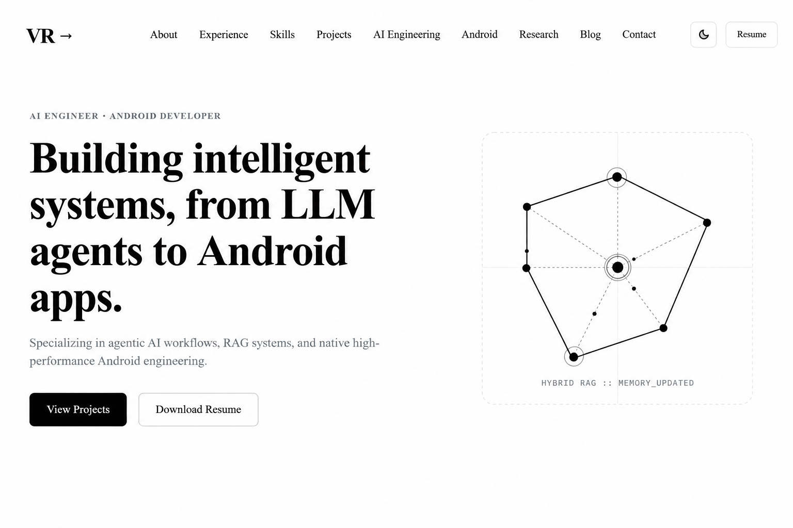
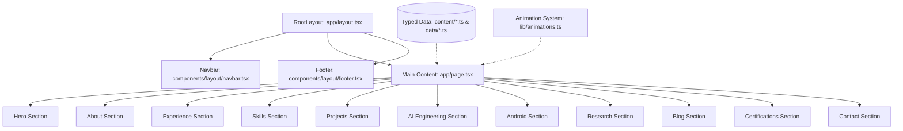

# Vicky Raut — AI & Android Engineering Portfolio

[](https://github.com/vickyraut/portfolio-website)
[](https://nextjs.org/)
[](https://react.dev/)
[](https://www.typescriptlang.org/)
[](https://tailwindcss.com/)
[](LICENSE)
[](https://vercel.com)

A state-of-the-art, high-performance personal portfolio website built with Next.js 16 (App Router), React 19, TypeScript, and Tailwind CSS v4. Designed around a strictly restrained monochrome design system, this codebase showcases production engineering capabilities across **Agentic AI Architecture** and **Native Android Engineering**.

---

## 📸 Overview & Visual Showcase




### Key Highlights

- **Pure Monochrome Aesthetics:** Hand-crafted design system utilizing `#FFFFFF`, `#F7F7F7`, `#000000`, and `#E5E5E5` with strict typography hierarchy.
- **100% Static Prerendering:** All 7 application routes (`/`, `/_not-found`, `/icon`, `/robots.txt`, `/sitemap.xml`) build 100% statically.
- **Centralized Motion System:** Unified Framer Motion animation variants (`fadeUp`, `staggerContainer`, `<Reveal>`) configured with `EASE_OUT_QUINT` easing.
- **Decoupled Architecture:** 0 hardcoded text inside components; 100% driven by typed data contracts in `data/` and `content/`.
- **Accessibility & SEO:** WCAG 2.1 AA compliant keyboard navigation, `aria-invalid` form states, and JSON-LD structured schemas (`Person`, `WebSite`, `ItemList`).

---

## 📚 Documentation Suite

| Guide | Description |
| :--- | :--- |
| [📁 **README.md**](file:///x:/portfolio-website/README.md) | Project overview, key highlights, quick start guide, and tech stack inventory. |
| [📁 **DESIGN.md**](file:///x:/portfolio-website/DESIGN.md) | Complete monochrome design system specification, typography scales, spatial rhythm, and component primitives. |
| [📁 **docs/ARCHITECTURE.md**](file:///x:/portfolio-website/docs/ARCHITECTURE.md) | System architecture, component hierarchy, static rendering strategy, and customization workflow. |
| [📁 **docs/DEPLOYMENT.md**](file:///x:/portfolio-website/docs/DEPLOYMENT.md) | Production build pipeline, Vercel setup, environment variables, and Lighthouse audit checklist. |

---

## ⚡ Quick Start

### Prerequisites

- **Node.js:** `v20.0.0` or higher
- **Package Manager:** `npm` v10+ (or `pnpm` / `yarn`)

### 1. Clone Repository

```bash
git clone https://github.com/vickyraut/portfolio-website.git
cd portfolio-website
```

### 2. Install Dependencies

```bash
npm install
```

### 3. Start Local Development Server

```bash
npm run dev
```

Open [http://localhost:3000](http://localhost:3000) in your browser.

### 4. Build for Production

```bash
npm run build
```

### 5. Lint & Type Check

```bash
npm run lint
```

---

## 🛠️ Technology Stack

| Layer | Technology | Usage / Purpose |
| :--- | :--- | :--- |
| **Framework** | Next.js 16.2 (App Router) | Static site generation (SSG), metadata route handlers, file-system routing. |
| **Language** | TypeScript 5.0 | Strict type safety across components, props, and content schemas. |
| **UI Engine** | React 19 | Server and client components, hooks, and `useSyncExternalStore`. |
| **Styling** | Tailwind CSS v4 | `@theme inline` design system, CSS variables, utility utilities. |
| **Animations** | Framer Motion 12 | Scroll-triggered entrance animations, SVG line drawing, crossfade transitions. |
| **Icons** | Lucide React + Inline SVGs | Clean 1.5px stroke icons (`Bot`, `Cpu`, `Database`, `GithubIcon`, `LinkedinIcon`). |
| **Fonts** | Google Fonts (`next/font`) | Inter (`--font-inter`) for body typography, JetBrains Mono (`--font-jetbrains-mono`) for technical code blocks. |

---

## 🏗️ Architecture Preview



---

## ⚖️ License

Distributed under the MIT License. See `LICENSE` for details.

---

## Author

<p align="center">
  <strong>Vicky V. Raut</strong><br>
  <em>AI & Software Engineer (CodeMonk)</em>
</p>

<p align="center">
  <a href="https://vickyraut.vercel.app/"></a>
  <a href="https://github.com/vickyraut"></a>
  <a href="https://www.linkedin.com/in/vickyraut/"></a>
  <a href="mailto:vraut12cr@gmail.com"></a>
</p>

<br>

---

<p align="center">
  <em>If you found this project helpful, consider giving it a ⭐ on GitHub. Your support is appreciated!</em>
</p>

<p align="center">
  Made with ❤️ by <strong>Vicky V. Raut (CodeMonk)</strong>
</p>