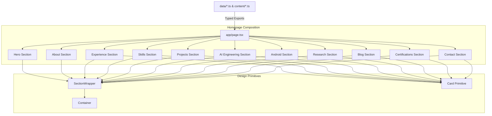

# ARCHITECTURE.md — System Architecture & Component Hierarchy

This document provides a technical breakdown of the Next.js 16 App Router setup, component hierarchy, state flow, animation orchestration, and static prerendering strategy.

---

## 🏗️ 1. Directory Blueprint

```
portfolio-website/
├── app/                        # Next.js App Router root
│   ├── favicon.ico
│   ├── globals.css             # Tailwind CSS v4 directives & theme inline mapping
│   ├── icon.tsx                # Dynamic PNG favicon generator (ImageResponse)
│   ├── layout.tsx              # Root HTML layout, font variables, Navbar, Footer, JsonLd
│   ├── page.tsx                # Main homepage composing all 11 portfolio sections
│   ├── robots.ts               # Dynamic robots.txt route handler
│   └── sitemap.ts              # Dynamic XML sitemap generator
├── components/
│   ├── layout/                 # Layout structure primitives
│   │   ├── container.tsx       # Responsive container max-width wrapper
│   │   ├── section-wrapper.tsx # Vertical rhythm & background color alternator
│   │   ├── navbar.tsx          # Smart sticky header with scroll hide/show
│   │   ├── mobile-menu.tsx     # Mobile drawer navigation overlay
│   │   └── footer.tsx          # Inverted monochrome footer
│   ├── ui/                     # Basic UI design system primitives (shadcn/ui style)
│   │   ├── button.tsx          # Primary / secondary / ghost button primitive
│   │   ├── card.tsx            # Card wrapper primitive with hover lift
│   │   ├── badge.tsx           # Rect and pill badge primitives
│   │   ├── input.tsx           # Accessible text input primitive
│   │   └── textarea.tsx        # Accessible textarea primitive
│   ├── shared/                 # Reusable domain UI elements
│   │   ├── section-heading.tsx # Standard section title/overline header
│   │   ├── section-divider.tsx # 1px line + node mark graphic divider
│   │   ├── tech-tag.tsx        # Technology tag chip
│   │   ├── reveal.tsx          # Scroll-into-view motion wrapper
│   │   ├── node-mark.tsx       # Node mark SVG vector icon
│   │   ├── github-icon.tsx     # Accessible GitHub SVG icon
│   │   ├── linkedin-icon.tsx   # Accessible LinkedIn SVG icon
│   │   └── json-ld.tsx         # JSON-LD structured data generator
│   └── sections/               # Modular homepage section implementations
│       ├── hero/               # Hero capability statement & neural graph
│       ├── about/              # Bio split & milestone timeline
│       ├── experience/         # Experience cards & vertical timeline
│       ├── skills/             # Categorized skill cards with chip inversion
│       ├── projects/           # Featured project spotlight & grid cards
│       ├── ai-engineering/     # AI capability cards & process flow diagram
│       ├── android/            # Mobile technology cards & crossfading PhoneMockup
│       ├── research/           # Peer-reviewed publication cards
│       ├── blog/               # Technical article cards with grayscale hover reveal
│       ├── certifications/     # Verified credentials & achievements grid
│       └── contact/            # Contact information & validated ContactForm
├── content/                    # Structured raw typescript content models
├── data/                       # Exported data interfaces & re-exports
├── hooks/                      # Custom React hooks
│   ├── use-scroll-direction.ts # Navbar scroll-direction state hook
│   ├── use-in-view.ts          # Framer Motion scroll observer hook
│   └── use-media-query.ts      # React 18 useSyncExternalStore responsive hook
├── lib/                        # Utilities & animation variants
│   ├── animations.ts           # Centralized Framer Motion easing & variants
│   ├── constants.ts            # Site metadata, nav items, social links
│   ├── types.ts                # TypeScript interfaces & types
│   └── utils.ts                # Tailwind merge (cn utility)
└── styles/                     # CSS design tokens
    └── tokens.css              # Custom CSS variables & raw color scales
```

---

## 🔄 2. Data Flow & Component Hierarchy



---

## ⚡ 3. Static Prerendering Strategy

All pages in this repository are **100% statically generated (SSG)** at build time:

1. **`app/page.tsx`**: Static HTML generated with all section markup embedded. Zero client-side data fetching waterfalls.
2. **`app/robots.ts` & `app/sitemap.ts`**: Evaluated during `next build` to emit static `robots.txt` and `sitemap.xml`.
3. **`app/icon.tsx`**: Generates a static PNG favicon at build time using `@vercel/og` ImageResponse without forcing edge runtime dynamic execution.

---

## 🎨 4. Animation Architecture (`lib/animations.ts`)

Transitions use custom `cubic-bezier(0.22, 1, 0.36, 1)` (`EASE_OUT_QUINT`) easing:

```typescript
export const EASE_OUT_QUINT = [0.22, 1, 0.36, 1];

export const fadeUp: Variants = {
  hidden: { opacity: 0, y: 24 },
  visible: {
    opacity: 1,
    y: 0,
    transition: { duration: 0.5, ease: EASE_OUT_QUINT },
  },
};

export const staggerContainer = (staggerChildren = 0.08): Variants => ({
  hidden: {},
  visible: {
    transition: {
      staggerChildren,
    },
  },
});
```
